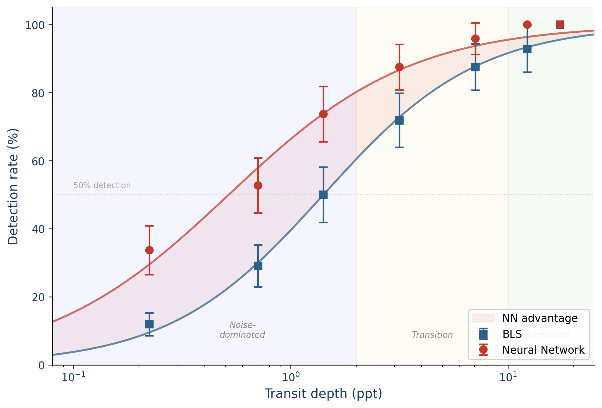

# Machine Learning for Exoplanet Transit Detection

A study comparing a neural network with the Box Least Squares (BLS) algorithm at finding exoplanet transits in Kepler light curves.

**Research question:** To what extent can a neural network detect exoplanet transit signals in stellar photometric light curves across varying transit depths, compared to the traditional Box Least Squares algorithm?

**Paper:** [exoplanet-transit-detection.pdf](exoplanet-transit-detection.pdf)

## Result

The neural network beat BLS in every depth bin, and the gap was largest for small planets.

- The network finds half of all transits at 0.52 ppt. BLS needs 1.42 ppt.
- Below 2 ppt, the network detects 20 to 24 percentage points more transits.
- Above 10 ppt, both find over 90%.

BLS looks for box-shaped dips, but real transits are rounded by limb darkening. The network learns the real shape, which matters most when the dip is close to the noise.

## Method

- 263 confirmed transits around Sun-like stars, from Kepler data
- Light curves normalised, phase-folded, and resampled to 201 points
- Sorted into 7 transit depth bins from 0.1 to 20 ppt
- BLS -> astropy, neural network -> scikit-learn (64 and 32 neurons), averaged over 10 seeds
- Both methods tuned to the same 5% false positive rate
